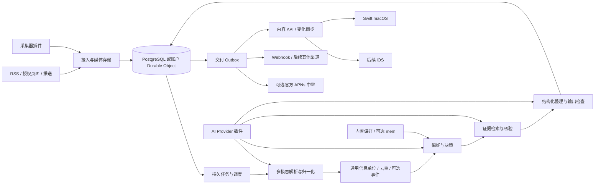

# 系统架构

更新：2026-10-17。业务管线图与模块表包含后续目标；当前实现子集见 [14](14-implementation-status.md)，客户端当前设计见 [06](06-apple-clients.md)与 [11](11-ui-design-system.md)。

## 总体结构

服务端采用 TypeScript + Hono 共享 HTTP 契约与领域规则，Node.js 24 LTS 和 Cloudflare Workers 分别提供入口。自托管用 PostgreSQL；Cloudflare 完全使用 Workers + SQLite-backed Durable Objects，不连接外部 PostgreSQL 或 Hyperdrive。每账户一个 AccountStore，限流和短期浏览器登录流程用 ControlStore。已实现阅读、鉴权和 RSSHub 公开来源的采集入库：Node 独立进程及 PG 持久任务，Cloudflare AccountStore Alarms/outbox/Queues；采集器实现放在 `server/src/plugins/`，共享 modules/plugins 提供注册、设置 DSL 和 host 动作，存储与任务不依赖 RSSHub 细节；AI 管线仍是后续能力。

Cloudflare 后续附件使用 R2，任务分发使用 Queues，长流程按需要使用 Workflows，周期触发使用 Cron Triggers / DO Alarms，模型缓存与向量能力按需要选 Workers AI / Vectorize。所有基础设施留在 Cloudflare；配置外部信息源、可选模型/OIDC 是业务集成，不把第三方数据库、Redis、对象存储作为部署依赖。详细映射、事务差异与部署步骤见 [TypeScript 迁移](15-typescript-transition.md)。

核心领域模型处理通用信息，内容主题由配置/用户目标表达。开源极客是推广入口，不成为代码中的内容限制。新领域通过来源配置、标签体系、rubric、输出模板及评测样本接入，不需要改核心对象或增加垂直产品分支。

图中的中继是独立可选服务。正文和证据只保存在用户选择的 Melted 服务器与明确授权的处理方；推送中继只获得通知路由所需的最小数据。

## 模块边界

| TypeScript 模块 | 职责与边界 |
| --- | --- |
| identity | 用户、角色、邀请、会话、设备；不承载来源凭据 |
| ingest | 输入验证、幂等、附件完成确认；不在 HTTP 请求里等待模型 |
| sources | 订阅、采集 cursor、授权引用、健康状态 |
| subjects | 用户目标、计划、主动获取 run 和覆盖报告 |
| normalize | 格式解析、OCR/视觉/ASR 适配、文本与时间轴 |
| content | InformationUnit、消息/资料/事件的引用与可读版本、阅读/收藏/隐藏状态、taxonomy 与组合查询，不要求每条有 event |
| events | exact/near duplicate、可选事件聚类、修订与新事实；非事件消息/资料不强制聚类 |
| judgments | typed decision、策略合成、阈值、评估版本 |
| evidence | claim、证据溯源、核验、矛盾与修正 |
| compose | 结构化简报、Markdown/HTML 派生、输出校验 |
| preferences | 显式偏好、反馈、学习版本、记忆适配 |
| delivery | outbox、同步通知、渠道交付状态 |
| plugins | 协议、授权、超时、健康、版本；不信任插件产物 |
| operations | 配额、成本账本、审计、导出删除、任务恢复 |

业务模块通过领域接口通信，不直接读取别的模块私有表。数据库变化和领域事件一起提交；网络/模型调用在事务外完成。

当前服务端按职责组织：`server/src/entrypoints/` 为 Node、Workers 与 CLI 入口；`http/` 负责 Hono 中间件和路由；`modules/` 保存 identity、content、sync、sources、collectors、ingest、jobs、plugins 的领域契约及运行时无关规则；`storage/postgres/`、`storage/cloudflare/` 分别实现数据访问；`config/` 与 `shared/` 保存配置和小型通用工具。目录与依赖规则见 [服务端工程说明](../server/README.md)。SQL 迁移保留在 `server/migrations/`，协议源头放根目录 `contracts/`，TypeScript 与 Swift 共用 schema/fixture，避免两端各自解释接口。后续领域按上表扩展 `modules/`，不预建空模块；客户端、插件示例、部署和评测分别位于 `apps/`、`plugins/examples/`、`deploy/`、`evals/`。

## 数据与部署

自托管 PostgreSQL 使用 owner 外键及 JSONB；Cloudflare 用账户 DO 内的 SQLite/JSON 保存相同产物。API 不暴露 SQL 方言。当前两端采用字面子串查询，支持中文；FTS/语义检索尚未实现，不把当前查询称作 FTS。后续可分别接 pgvector / Vectorize，并保留文本路径。

当前统一内容查询承载全部/未读/收藏、分类、标签、关注主题与文本搜索；时间、facet 计数和客户端缓存是后续扩展。筛选只改变结果集，不更改偏好。后续完整方案中，结果分页和 facet 计数都先限定 owner/权限，查询哈希与稳定快照绑定 cursor；客户端按查询身份隔离缓存，丢弃迟到旧查询响应。taxonomies 和关联关系随变化日志同步，详见 04。

中文搜索须在 M0 单独验证分词与召回方案，必要时增加授权域内的子串候选检索；不能用英文 FTS fixture 代替中文验收。服务端与本机缓存搜索都标注覆盖范围，结果先做所有权过滤，再分页返回。

附件尚未实现：自托管规划存储在服务端持久卷，通过 `BlobStore` 接口可替换为 S3 兼容服务。内容寻址去重只在授权域内使用；下载始终验证所有权。持久卷和数据库必须协同备份，备份含模型配置但不明文导出密钥。

自托管提供 Dockerfile 与 Compose：Node API、迁移任务、PostgreSQL，公网接入由 TLS 反向代理终止。Cloudflare 用 Wrangler 发布 Worker 与两个 SQLite DO namespace。Dockerfile 支持跨架构构建，实际已测架构记录在验收中。依赖锁入 package-lock；镜像固定版本系列，正式发行再锁 digest。所有本机后端、数据库与 workerd 调试经 Apple Container，Swift App 原生运行。

自托管起点预算假设为 2 vCPU、4 GiB RAM、20 GiB 磁盘、1–5 用户；音视频处理可明显增加要求。它不是已测量最低配置，也不包括本地大模型内存。

## 持久任务、并发与恢复

任务表字段包含 `stage`、`input_ref`、`input_hash`、`policy_version`、`pipeline_version`、`provider_version`、`status`、`attempt`、`available_at`、`lease_until`、`lease_owner`、`fencing_token`、`cancel_requested`。

当前采集任务已实现短事务领取、账户并发限制、租约/fencing、事务入库与崩溃恢复，PG 按账户锁串行化写入，CF 以 DO 事务和 outbox 协调；见 [RSSHub](../server/docs/rsshub.md)。以下为后续通用处理管线设计。自托管 worker 用短事务领取任务，基于 `FOR UPDATE SKIP LOCKED` 避免互等。该机制适合队列式访问，不提供一般一致查询视图，见 [PostgreSQL SELECT 文档](https://www.postgresql.org/docs/current/sql-select.html)。模型调用期间不持有行锁；租约续期，过期可重领，迟到 worker 以 fencing token 防止覆盖新结果。

Cloudflare Queues 同样采用至少一次投递；账户 DO 事务内保存任务代际、状态、幂等键和 outbox，再发队列消息；消费前后校验 generation/fencing，重试不重复发布。不能把队列 ack 视为数据库提交。

执行语义是至少一次，业务结果用唯一键去重。结果键包括 stage、输入与依赖产物 hash、pipeline/rubric/provider 版本和授权域；个性化阶段还包括 owner、完整 policy/context hash、处理目的地授权版本。不得仅用看起来相同的 policy 版本号跨用户缓存。模型外部请求是否重复收费取决于 provider 的幂等能力，不能宣称 exactly-once。状态转换：`pending -> leased -> succeeded`；可进入 `retry_wait`、`failed`、`cancelled`、`blocked_budget`、`blocked_consent`。

429/暂时网络错误使用指数退避和随机抖动，遵守 Retry-After；鉴权或配置错误停止重试并向管理员报告；无效文件隔离；超过重试上限进入可观察失败队列。每阶段保存校验通过的产物，从失败处继续。取消不保证撤回已发出的模型调用，结果可丢弃但成本照实登记。

briefing revision、变化日志和交付 outbox 在同一事务提交。客户端根据变化日志拉取真实内容；APNs/SSE 只提示有变化，不是事实源。webhook 用 delivery ID 和签名支持接收方去重；对外网络交付不能承诺恰好一次。

同步序号必须符合提交顺序：PostgreSQL 每账户在同一事务锁定计数行，DO 在 transactionSync 内递增序号并写变更，锁持有到提交。不能把数据库 sequence 的最大已见 ID 当稳定水位，否则较小序号晚提交会被客户端跳过。snapshot 使用同一一致视图读取实体和水位，分页固定快照；负载上来后再评估别的提交日志方案。

首期可在短期一致事务中生成账户 snapshot 的不可变分页投影和水位，再按 snapshot_id/TTL 读取；不要跨多次 HTTP 请求长期持有数据库事务。实体删除/权限撤销仍须在分页读取时执行授权检查；过期返回重建指示。快照生成与变化追赶需有容量/期限上限和清理任务。

## 成本与调度

为用户、Subject、运行和媒体设定日/月上限。模型调用前原子预留最坏预算，结束后对账；未知费用保留待对账占用，不能因为超时自动返还而允许无限重试。预算不覆盖隐性收费时，适配器标记估算质量并要求更保守上限。

先做廉价解析、规则去重和粗筛，再付费抽取/核验/生成。公共授权信息可在相同来源权限范围内复用解析与抽取；个人判断和输出必须按用户分别运行。不能跨用户复用私有正文或泄露其存在。

定时计划按 IANA 时区执行，保存 UTC 下次执行时间；`schedule_id + scheduled_slot` 唯一，避免多实例重复创建。夏令时约定：不存在的本地时间顺延至下一个有效时间，重复时间只运行一次。机器停机后的补跑默认合并为最新一次，避免集中调用。手动请求和定时任务公平调度，单用户不能耗尽全部 worker。

## 安全与隐私

TLS、严格认证、服务器端权限检查是基础。认证方式由服务器声明并由客户端协商；启用 P-256 持有权时服务端只保存公钥；会话 access/refresh token 存哈希；OIDC 采用 state/nonce/双侧 PKCE/短期一次性码，不用 email 自动关联身份；provider/source/plugin 密钥加密保存，主密钥来自独立 secret 文件或环境配置，不进日志、客户端和普通导出。PostgreSQL 多用户表加 owner 外键约束；Cloudflare 根据认证结果访问私有账户 DO，RLS 可作额外防线但不替代业务鉴权。

正文、来源 HTML、转录和插件输出均视为不可信数据，不能改变系统指令、获得工具授权或执行命令。LLM 只返回受 schema 限制的值；权限、网络访问、预算和状态转换由代码控制。

URL 抓取、媒体代理、provider 回调和 webhook 防 SSRF：校验规范化 URL、解析并验证 IPv4/IPv6、连接固定到获准地址、逐跳检查重定向，阻止回环、私网和云元数据。内网自托管来源须由管理员逐来源显式放行，不能关闭全局保护。参考 [OWASP SSRF 防护](https://cheatsheetseries.owasp.org/cheatsheets/Server_Side_Request_Forgery_Prevention_Cheat_Sheet.html)。App 到用户主动选择的内网服务器属于独立信任边界，不受公共 URL 抓取策略禁止。

这是服务端可读数据架构，不宣称端到端加密。第三方推理、记忆和抓取传输需按用户授权范围执行；运营者和 provider 可能看到授权数据。日志默认只存 ID、状态、耗时、版本和成本，不记录正文/密钥；诊断正文采样须单独授权且限时。

## 运维与删除

提供健康、就绪、队列积压、最老任务、阶段错误、插件健康、每用户成本和交付重试指标。追踪 ID 贯穿摄取到交付；用户看到短错误与重试入口，管理员看到技术诊断。

删除账户先停止任务/计划和撤销设备、会话、渠道，然后清除正文、附件、向量、偏好、外部 mem 与中继绑定。外部清除失败保持待办并报告；备份轮换保留期限单独说明。恢复备份后重放删除 tombstone，避免把已删除账户重新激活。默认原始资料保留 30 天、任务日志 14 天为候选设置，运营者可修改并向用户公开；证据过期须影响原生依据状态。

删除/撤销增加账户 generation 或同等提交栅栏，worker 发布及外发前检查；发布事务与删除事务锁定同一账户 generation 行，以免检查和写回之间发生竞态。旧任务不能在清理后重新写回。外发领取记录与代际检查原子执行，但已开始的外部请求可能无法撤回，应记录并继续清除可控副本，不能承诺瞬时撤回。契约与客户端状态映射按 04/11 统一，工程实现遵守 [开发规范](12-development-standards.md)。
