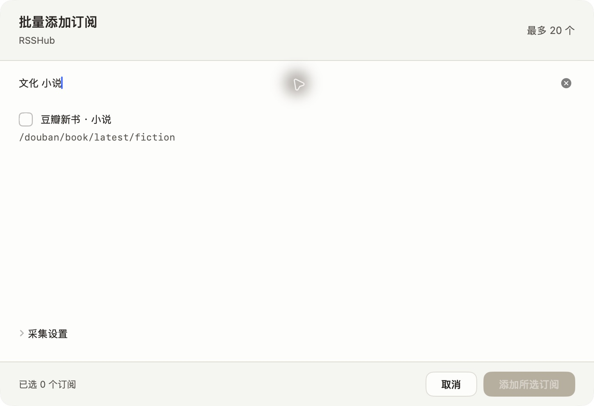

# 当前契约与采集插件 SDK 验收

日期：2026-10-17。工作基线 d36ff41；本记录对应当前契约清理与插件 SDK 改动。服务端执行均在 Apple Container 内；Swift 使用宿主原生工具链。

## 实现范围

- 首版仅保留当前来源 `plugin/config_version/configuration` 契约，移除旧平面 route 转换、输出别名、RSSHUB_CONFIG/YAML rsshub 别名、旧来源升级和旧账户字段。当前认证 version/auth 与插件 collection 是必需字段；未知版本明确拒绝。
- 保留当前初始建表迁移及幂等重放，不自动删除开发数据库或凭据。编译前清理 dist，已核对删除的 legacy 模块和 004 转换迁移不会残留在输出中。
- 新增 BaseCollectorPlugin、独立运营/账户配置 schema、配置与部署钩子、有限采集上下文、有界 JSON 请求、稳定错误和结果构造。RSSHub 使用同一基类和 HTTP 工具。
- 新增可生成 boilerplate、单元测试、真实 workerd 执行测试及 [开发指南](../../../../server/docs/plugin-development.md)。模板包含多来源 table DSL、建议批量创建与 collect/validate 动作；注册与启用仍须由运营者在组合根和清单中明确配置。

## 自动检查

| 检查 | 结果 |
| --- | --- |
| `rtk proxy python3 scripts/dev.py check` | TypeScript、格式、35 项单元、43 项集成、插件预检与 Worker dry-run 全通过 |
| MeltedKit Swift 测试 | 22 项通过 |
| macOS Swift 测试 | 20 项通过 |
| 主回归合计 | 120 项通过 |
| SDK / host / contracts 定向复核 | 最后调整后 12 项通过 |
| `plugins:new -- validation-sample` | 实际生成成功；生成测试 1 项通过，完整 TypeScript 检查通过；随后删除此次生成的临时样例 |
| `npm run build` | 清理旧 dist 后重新编译并复制当前 SQL；旧模块残留检查为空 |
| Worker 打包 | 987.28 KiB，gzip 173.58 KiB；无生产部署 |
| `sh scripts/build-macos.sh` | 构建通过，codesign 深度严格校验通过 |
| 文档/设计静态检查与 `git diff --check` | 通过；静态检查不代表原生布局或辅助功能验收 |

集成检查包含 PG 新 schema/迁移重放、当前来源契约、两端账户隔离、重复投递、任务租约与 fencing、停用/删除迟到结果、DO/Alarm/Queue 恢复。旧版本升级用例已由当前全新 schema 验证替代。模板集成经过 Wrangler 与真实 workerd 的 registry/service/result 路径，上游采用注入 fixture。

## 真实来源回归

完整结果见 [live.json](live.json)。请求时间为 2026-10-17 13:04:52–13:05:04 UTC。自托管实例固定镜像：

```text
ghcr.io/diygod/rsshub@sha256:1db5e6b65a2cbabc95def7e495801ccd50ce5c77ade6408d454867333c28b1a4
```

| 类别与路由 | Node / PostgreSQL 入库 | workerd / SQLite DO 入库 | 重采新增 |
| --- | --- | --- | --- |
| 新闻 `/bbc/world-asia` | 18 | 18 | 0 |
| 文化生活 `/douban/book/latest/fiction` | 10 | 10 | 0 |
| 社区 `/hackernews` | 30 | 30 | 0 |

六次首采均 complete、无效项为 0，Worker 错误为 0。Node 重采分别记录 18/10/30 重复项；DO 条件重采 received 为 0。豆瓣未提供发布时间，数据库保持为空。此次临时测试账户及所属数据已清理；未向现有账户注入采集结果。

## 原生当前契约检查

检查构建：Melted 0.2.0（13）、com.alkinum.melted、arm64，macOS 27.0.1（26A434）。已检查的可执行文件 SHA-256：

```text
4eca1f66f6175e574f609a9245cdc6d7db42f078d4996bfc0736e4986554c766
```

重新启动本地 API 与新构建 App，确认既有会话恢复及 7 条开发样例加载。进入设置 → 来源 → 添加 RSSHub 订阅，搜索“文化 小说”得到豆瓣小说条目，当前必需 collection 与配置建议可正常解码并呈现；未创建来源。



本次是浅色、100% 阅读字号的当前契约冒烟检查；没有重复完整深浅色/辅助功能矩阵。此前多来源交互画面与逐行操作见 [订阅集合验收](../route-settings/README.md)。

## 边界

SDK 是仓库内受信任 TypeScript 模块的开发入口，未发布独立 npm 包，基类不是代码沙箱。模板真实执行通过不代表新上游的网络、授权或许可证已验证。真实 RSSHub 结果只覆盖上述三条路由与当时 feed 窗口；不承诺完整历史或其他路由可用。无远端 CI、生产部署、iOS 运行或最低 macOS 版本验证。
