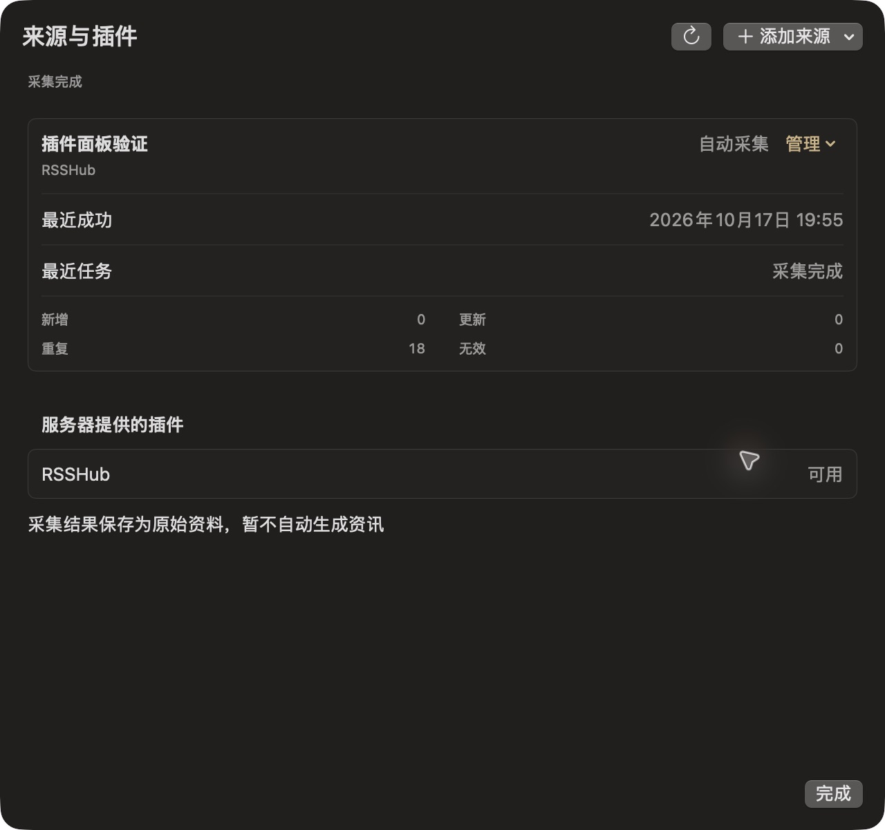
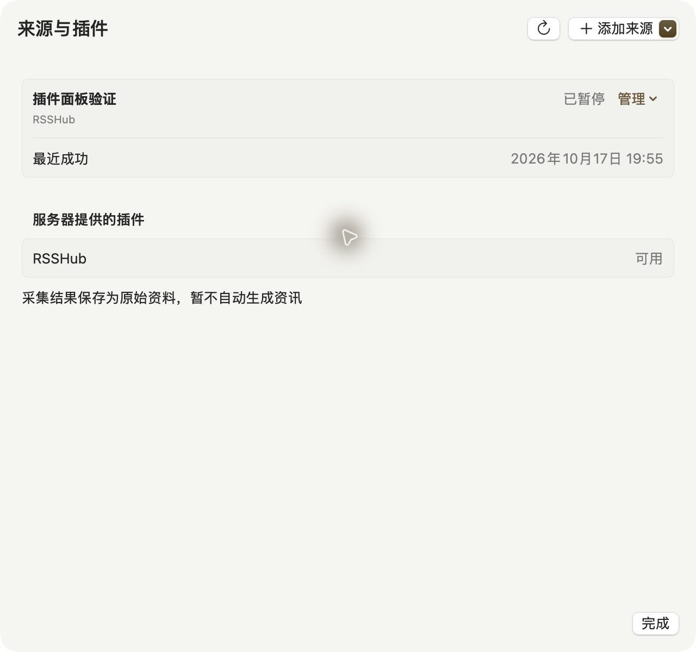
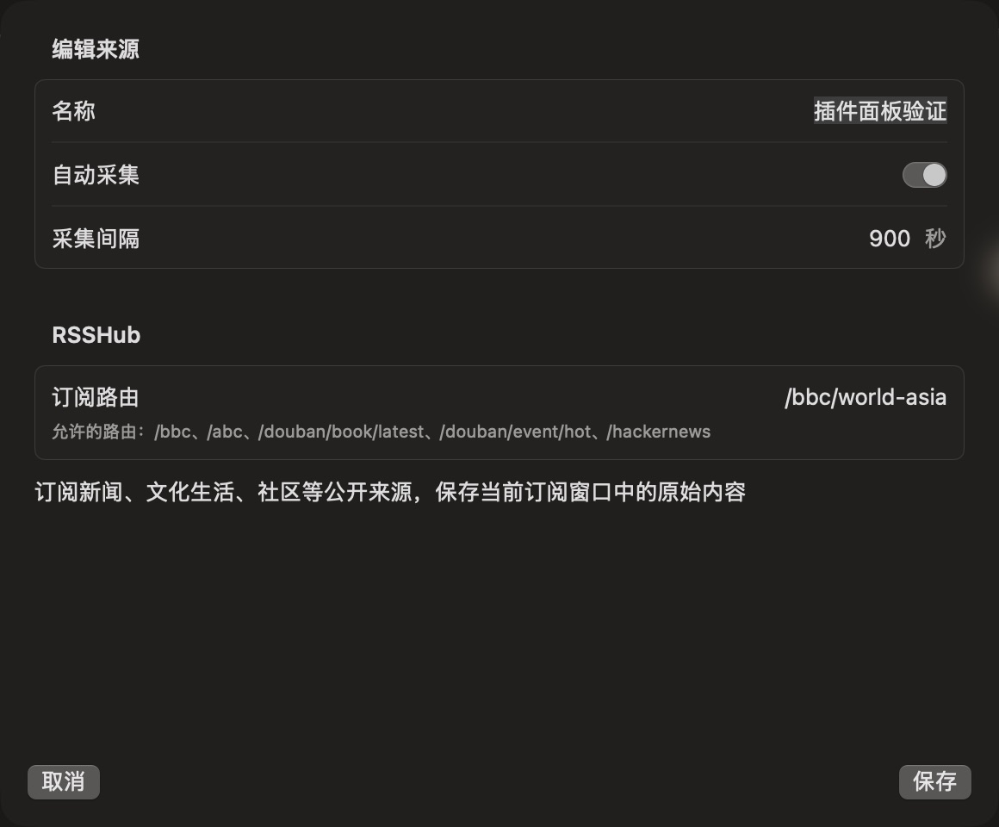
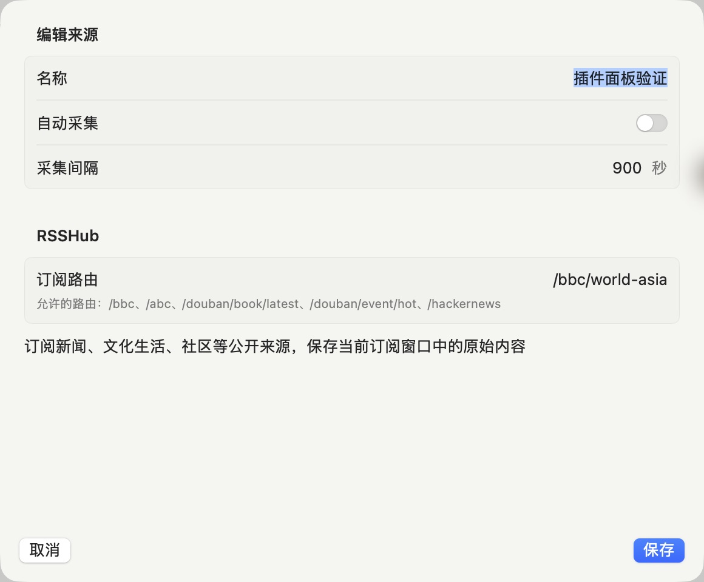
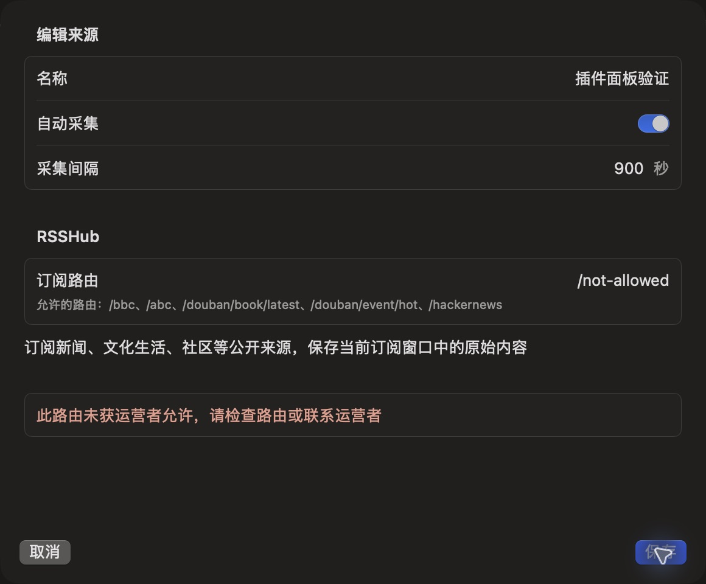

# 插件模块、设置 DSL 与原生管理验收

日期：2026-10-17。此次是在已提交的 RSSHub 采集闭环上，按用户要求分离具体采集器、实现可扩展模块注册，并让原生客户端按服务器 DSL 管理来源与动作。设计与使用见 [插件说明](../../../../server/docs/plugins.md)。

## 实现与复审

- `src/plugins/rsshub/` 独立持有配置、路由策略、HTTP 和 JSON Feed；共享 plugins host、任务和存储使用通用 plugin/config_version/configuration。独立测试模块使用不同配置与动作 ID，验证无需增加 RSSHub 分支。
- DSL v1 提供四种有限控件；客户端不执行脚本、加载 HTML 或采用任意 endpoint。动作 ID/文案来自模块，执行效果限 collect/validate，v1 额外参数明确禁用，JSON Schema 与运行时保持一致。
- PostgreSQL 004 / DO v2 保留旧来源身份、配置版本、checkpoint、排队任务和创建幂等响应；旧 route 请求兼容，新调用带插件与来源版本。
- 复审修复：旧 route-only PATCH 意外重置启停/间隔；配置对象键序导致多余代际；运行时 descriptor 身份与目的地凭据泄露检查；模块返回配置再次校验；PLUGIN_CONFIG 下独立 RSSHub secret 未传入；迟到 receipt 刷新覆盖最新来源；原生重复间隔标签、页眉宽度与计数对齐。
- API 与 worker 的 Compose 环境同时传入 PLUGIN_CONFIG。运营者秘密不进入来源返回或 DSL，采集输出 hash 由 host 计算。

代码提交：服务端/契约 `2385890`，原生界面 `7624298`。

## 自动与编译验证

| 验证 | 结果 |
| --- | --- |
| `rtk proxy python3 scripts/dev.py check` | 通过：类型、格式、28 单元 + 42 集成测试、插件预检、真实 Worker dry-run |
| Worker 包 | 980.40 KiB，gzip 171.81 KiB；不是公网部署 |
| `scripts/dev.py exec npm run build` | 通过，编译输出与 migrations 完整 |
| 编译 CLI 迁移重放 | 从 001–003 升到 004，重放 2 次，已有 briefing 保留；见 [报告](migrations.json) |
| 旧来源升级 | PG 旧 document/checkpoint/idempotency fixture 重放；真实 workerd 的旧 SQLite 文档、alarm/outbox 与队列任务重启恢复通过 |
| 编译 API smoke | health 200、插件发现 v1、来源与插件匿名访问 401、SIGTERM 退出 0；见 [报告](compiled-smoke.json) |
| `swift test --package-path apps/apple/Packages/MeltedKit` | 19 通过：15 Core/Rendering + 4 DesignSystem |
| `swift test --package-path apps/macos` | 19 通过；含冲突恢复、动作重复点击、未知结果、迟到刷新不能恢复已删除来源 |
| 静态设计与补丁 | 60 Markdown / 422 本地链接 / 5 JSON 示例，34 色彩对最低 4.71:1；token parity、生成 token 检查与 git diff --check 通过 |
| `sh scripts/build-macos.sh` | 原生构建与固定 Apple Development 签名完成；codesign --verify --deep --strict 通过 |

两后端合约同时验证账户隔离、动作幂等与版本栅栏、任务竞争、租约重领、写入回滚、重复/修订/partial、停用/删除迟到结果。异常来源处理沿用 RSSHub 回归用例。表单 select 控件在共享 fixture 与类型测试中验证；当前公开 RSSHub 表单使用 text/integer/boolean，未声称 select 已通过真实来源界面验收。

## 真实来源

固定镜像 `ghcr.io/diygod/rsshub@sha256:1db5e6b65a2cbabc95def7e495801ccd50ce5c77ade6408d454867333c28b1a4`，Apple Container 内自托管实例；请求时间 2026-10-17 11:54:18–11:54:30 UTC。完整结果见 [live.json](live.json)。

| 公开路由 | Node/PG 首次入库 | workerd/SQLite DO 首次入库 | 重复采集 |
| --- | --- | --- | --- |
| BBC `/bbc/world-asia` | 18 | 18 | 两端新增 0；Node 重复 18，DO 条件响应 received 0 |
| 豆瓣新书 `/douban/book/latest/fiction` | 10 | 10 | 两端新增 0；Node 重复 10，DO received 0；缺发布时间保持空 |
| Hacker News `/hackernews` | 30 | 30 | 两端新增 0；Node 重复 30，DO received 0 |

三路均 complete，invalid 0，workerd 捕获错误 0。Node 使用编译后 worker，DO 使用真实 Alarms/Queues；不是直接把抓取结果写数据库。临时测试账户和正文已清理。这只是该时刻实例窗口的可用性，不保证上游持续可用或历史完整。

## 原生窗口与操作

验证构建：0.2.0 (13)，`com.alkinum.melted`，macOS 27.0.1 (26A434)，arm64。签名二进制 SHA-256：`f7b99f0d8b280c5c8c2ee5d98acf1e8b2d72c5d438d0afecf81093ea82b51f71`。使用当前 checkout 的 `build/Melted.app` 重新启动；原生 CUA/AX 检查，不是网页预览。来源 sheet 640×600 pt，设置编辑 sheet 580×480 pt，阅读字号 100%，深浅两种 App 外观；辅助设置未另行改变。

实际操作：连接本机 API → 设置/来源与插件 → 添加 RSSHub → 填写名称与路由 → 保存 → 自动采集；检查配置返回仅校验的说明；立即采集返回真实 receipt，最终新增 0、更新 0、重复 18、无效 0，最近成功随任务更新。编辑间隔 100 秒时保存禁用；未授权路由被服务端拒绝，输入仍保留；恢复有效路由并关闭自动采集后保存，状态为已暂停，采集动作禁用，重开表单保留已存设置。

亮暗截图：

| 深色列表与实际 receipt | 浅色列表与暂停 |
| --- | --- |
|  |  |

| 深色 DSL 表单 | 浅色 DSL 表单 |
| --- | --- |
|  |  |

测试后恢复原深色主题，清理仅本次创建的“插件面板验证”来源及 18 条原始数据，结束为验收启动的后台 worker；未删除既有 briefing 或账户。

## 交付边界

只开放受信任的编译模块和 collect/validate 两种 host 动作；任意动态代码、远程 invoke、动作额外参数、插件市场、私人订阅、iOS 管理页面与 AI 自动整理均未实现。原生网络失败/409 的部分状态由模型测试覆盖，未完成最低系统、完整 VoiceOver、系统辅助设置及全窗口矩阵。Apple Development 签名不等于 Developer ID 公证发行；本地 workerd 不等于 Cloudflare 公网部署，仓库没有 GitHub Actions 工作流。
