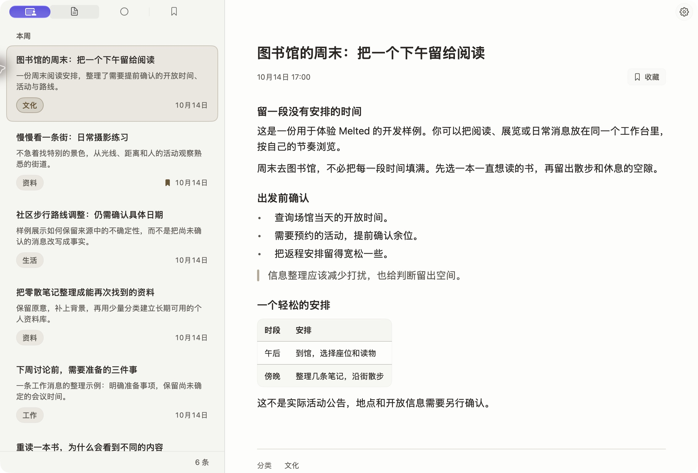
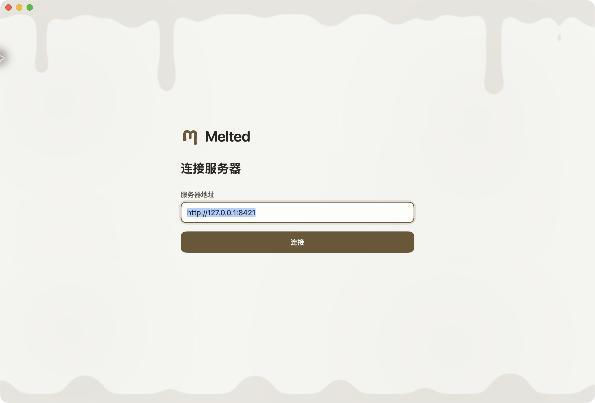

<p align="center">
  <picture>
    <source media="(prefers-color-scheme: dark)" srcset="assets/brand/lockup-dark.svg">
    
  </picture>
</p>

<p align="center"><strong>让信息回到适合阅读的样子。</strong></p>
<p align="center">原生 macOS 阅读器，配上可以自己部署的信息服务。</p>

<p align="center">
  <a href="LICENSE"></a>
  <a href="apps/macos/README.md"></a>
  <a href="#项目进度"></a>
</p>

<p align="center">
  <a href="#快速开始">快速开始</a> ·
  <a href="#部署">自行部署</a> ·
  <a href="#项目进度">项目进度</a> ·
  <a href="CONTRIBUTING.md">参与贡献</a> ·
  <a href="https://github.com/backrunner/melted/issues">反馈问题</a>
</p>

<picture>
  <source media="(prefers-color-scheme: dark)" srcset="assets/screenshots/reader-dark.png">
  
</picture>

Melted 是一个通用个人信息工作台。资料、消息、观点和兴趣内容，都可以放进同一个阅读界面，按自己的节奏浏览、搜索和收藏。服务端负责存储和提供内容，原生客户端负责呈现；你可以选择自己信任的服务器，也可以自行部署。

**目前处于 0.2 开发阶段，尚无正式安装包。** 已实现认证、RSSHub 公开来源采集与原始入库、内容存储与原生阅读基础；AI 整理和偏好学习仍在建设中。采集数据暂不自动生成简报。上图是实际 SwiftUI 应用，内容由本机服务器导入，属于开发样例，不代表 AI 处理效果。App 不内置内容，也不提供加载样例的入口。

## 阅读，保持简单

| | 当前能力 |
| --- | --- |
| **安静的阅读界面** | 原生 SwiftUI / AppKit 窗口，暖白与暖炭灰主题；支持 Markdown 标题、列表、引用、等宽代码与离线语法高亮、表格和最高 200% 阅读字号。 |
| **视图与筛选** | 全部、未读和收藏视图；文本/分类/标签/关注查询 API 与搜索面板组件已有，当前原生面板挂载仍待修复。 |
| **保留判断依据** | 来源按需展开；有佐证、单一来源、尚未确认和存在不同说法分别呈现。客户端显示服务端提供的状态。 |
| **选择你的服务器** | Node.js + PostgreSQL，或 Cloudflare Workers + SQLite Durable Objects，共用 API 契约和隔离测试。 |
| **适配服务器的登录方式** | 支持服务器声明的账号密码、API Key、OIDC 浏览器或 P-256 身份密钥；密码和 API Key 只用于交换会话。 |

<details>
<summary>查看连接入口</summary>



输入服务器地址后，先查看运营者和处理说明，再选择信任与登录。身份密钥保存在系统钥匙串，不能用来证明 Apple 账号身份。

</details>

## 快速开始

需要 macOS、Xcode、Python 3，以及已启动的 [Apple Container](https://github.com/apple/container)。客户端最低目标为 macOS 14；本机 Node、PostgreSQL 和 workerd 均通过容器运行。

```sh
git clone https://github.com/backrunner/melted.git
cd melted

# 启动本机数据库与服务端
python3 scripts/dev.py up

# 构建并打开原生客户端
sh scripts/build-macos.sh
open build/Melted.app
```

在 App 中连接 `http://127.0.0.1:8421`，确认服务器后登录。新账户没有内容时会显示空列表。账户和认证方式的配置见 [认证指南](server/docs/authentication.md)。

<details>
<summary>开发签名与本机测试数据</summary>

构建脚本将唯一可用的 Apple Development 证书固定在 `.local/macos-signing.json`，后续沿用同一身份。存在多个证书时需显式选择；没有开发证书时，可以主动使用 ad-hoc 签名：

```sh
python3 scripts/macos-signing.py --configure -
sh scripts/build-macos.sh
```

ad-hoc 构建的身份会随二进制变化，钥匙串可能需要再次授权。同步钥匙串不可用时，可以明确选择本机凭据继续；跨设备同步与公证发行仍需单独验证。更多说明见 [开发签名](apps/macos/README.md#固定开发签名)。

需要阅读测试数据时，运营者可在服务端为指定账户导入：

```sh
python3 scripts/dev.py exec npm run cli -- import-demo ACCOUNT_ID /workspace/contracts/fixtures/development-library.json
```

将 `ACCOUNT_ID` 替换为目标账户 ID。此操作通过服务端 CLI 完成，不开放 HTTP 样例导入接口。

</details>

| 快捷键 | 操作 |
| --- | --- |
| `⌘F` | 搜索与筛选 |
| `⌘R` | 刷新资讯 |
| `⌘,` | 设置 |
| `⌘+` / `⌘-` / `⌘0` | 放大、缩小、还原阅读字号 |

## 部署

| 方式 | 运行环境 | 持久化 | 配置 |
| --- | --- | --- | --- |
| 自托管 | Node.js 24 + Hono | PostgreSQL 17 | [Compose](compose.yaml)、[环境变量](.env.example) |
| Cloudflare | Workers + Hono | SQLite Durable Objects | [Wrangler](server/wrangler.jsonc) |

**自托管**：复制 `.env.example` 为 `.env`，设置随机数据库密码、稳定 server ID、运营者和 HTTPS origin，再运行 `docker compose up --build -d`。API 默认只绑定 `127.0.0.1:8421`，数据库不发布端口；公网访问需要 HTTPS 反向代理。

**Cloudflare**：填写 Wrangler 顶层配置，在开发容器中运行 `python3 scripts/dev.py exec npm run worker:check`。配置自己的 Cloudflare 账号后再执行 `worker:deploy`；占位配置会被拒绝。这个部署方式不依赖外部数据库、Redis 或 VPS。

RSSHub 可连接运营者的 HTTPS 实例，或使用可选 Compose profile；macOS“设置 → 内容 → 来源与插件”按服务器 DSL 管理来源并执行插件动作；新增采集器见 [插件机制](server/docs/plugins.md)，独立 worker 与本机运行见 [RSSHub 采集指南](server/docs/rsshub.md)。

也可使用独立插件直接订阅 [RSS / Atom / JSON Feed](server/docs/feed.md)，以及 [Bluesky、Fediverse 与 Nostr](server/docs/social-collectors.md)。Fediverse 当前支持 Mastodon 兼容公开 API；Nostr 使用运营者授权的 relay 并验证事件签名。所有来源复用原生配置、多订阅管理和原始入库流程。

部署步骤、认证与迁移说明见 [部署指南](deploy/README.md)、[认证配置](server/docs/authentication.md) 和 [服务端工程说明](server/README.md)。

## 项目进度

| 已有基础 | 后续计划 |
| --- | --- |
| 双部署、认证协商、多用户隔离；RSSHub 采集与持久任务 | 上传/推送摄取、第三方插件执行 |
| 查询 API、阅读与收藏状态 | 原生搜索入口修复；AI 整理、核验、偏好与记忆 |
| macOS 原生阅读器 | 正文磁盘缓存与完整离线同步 |
| Swift 共享基础包 | iOS、可选 APNs 中继与发行准备 |

服务端搜索目前采用字面子串匹配；原生搜索入口的源码缺口见 [当前设计复核](.agents/13-design-review.md)。查询快照有效期为 5 分钟，上限为 2,000 条、8 MiB。阅读器不执行原始 HTML，也不自动加载远程图片。完整实施范围与验证记录见 [实施记录](.agents/14-implementation-status.md)。

## 开发与贡献

```sh
# 设计与生成资产、服务端双后端测试、Swift 测试和 macOS 构建
sh scripts/check.sh

# 在容器内构建服务端
python3 scripts/dev.py exec npm run build

# Cloudflare 本地模拟器（前台运行）
python3 scripts/dev.py worker

# 停止项目容器，保留数据库卷
python3 scripts/dev.py down
```

`.local/` 存放本机环境文件，`melted-pg-data` 卷保存数据库。真实凭据、数据库和构建产物不纳入 Git。

| 目录 | 职责 |
| --- | --- |
| `apps/macos` | 原生 macOS 应用 |
| `apps/apple/Packages/MeltedKit` | Swift 协议、设计系统与 Markdown 渲染 |
| `server` | TypeScript 领域模块、HTTP 与两种存储适配 |
| `contracts` | OpenAPI、JSON Schema 与共享 fixture |
| `assets` | 品牌矢量资产与真实应用截图 |
| `.agents` | 设计、开发约定和带日期的验证记录 |

欢迎通过 [Issue](https://github.com/backrunner/melted/issues) 描述使用场景、问题和建议，也欢迎提交改进。开始前请阅读 [贡献指南](CONTRIBUTING.md)；客户端模块见 [macOS 工程说明](apps/macos/README.md)，设计入口见 [设计索引](.agents/README.md)、[当前 UI 规范](.agents/11-ui-design-system.md)与[视觉资源](.agents/design/README.md)。

## 许可

Copyright © 2026 Melted contributors。

Melted 原创代码、文档与品牌资产采用 **GNU GPL 第三版或任何后续版本（GPL-3.0-or-later）**，不提供任何担保。完整条款见 [LICENSE](LICENSE)，适用范围见 [COPYRIGHT](COPYRIGHT)，第三方依赖保留各自的许可与版权声明，见 [THIRD_PARTY.md](THIRD_PARTY.md)。项目当前没有 App Store 分发例外。
